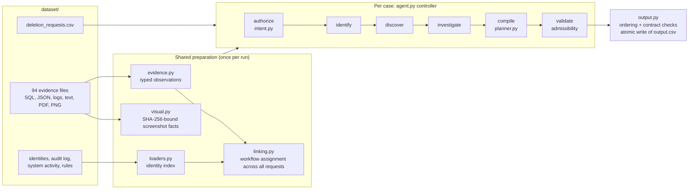

# Ghost Data Still Exists: a deterministic deletion-audit agent

This is my solution to **HackerRank Orchestrate (October 2026), "Ghost Data Still Exists"**. For each of 518 deletion requests, the agent reads a synthetic company's records and evidence and decides whether the requested deletion is actually finished.

It does three things:

1. It checks whether the request really asks for deletion.
2. It resolves the person's current and historical identifiers.
3. It reconstructs, from logs, database snapshots, JSON exports, PDFs and screenshots, which copies of their data still exist on the audit date.

It then returns `COMPLETE`, `INCOMPLETE` or `NOT_APPLICABLE`, together with an ordered list of findings, remediation steps and verification checks.

Every decision comes from explicit rules applied to the supplied evidence. No language model is called at run time, and two runs produce byte-identical output.

> **Scope.** The agent reasons only over the files supplied with the challenge, all of which describe an imaginary company (Northstar Shop). A `COMPLETE` verdict means the supplied evidence, read up to `audit_at`, shows no remaining copy or active recreation path. It does not prove deletion in systems the evidence does not cover.
>
> **Result.** No ranking or score for this October round is claimed here. The figures below are measurements of this code against the public sample answers and the output contract.

## Contents

- [The challenge](#the-challenge)
- [How the agent works](#how-the-agent-works)
- [Decision rules](#decision-rules)
- [Safety and correctness boundaries](#safety-and-correctness-boundaries)
- [Evaluation](#evaluation)
- [Reproduce](#reproduce)
- [Submission package](#submission-package)
- [Limitations and trade-offs](#limitations-and-trade-offs)
- [Privacy and security](#privacy-and-security)
- [Repository layout and provenance](#repository-layout-and-provenance)

## The challenge

The full contract is in [`problem_statement.md`](problem_statement.md). In short:

- **Input.** Each row of `dataset/deletion_requests.csv` is one case: `case_id, email, requested_at, reported_status, reported_at, audit_at, request_text`. `reported_status` is the workflow's own claim and is not proof.
- **Context.** The context files are:
  - `user_identities.csv` (850 rows)
  - `user_audit_log.csv` (306 identity changes)
  - `system_activity.csv` (4,011 sync, export, backup, restore, indexing and deletion events)
  - `deletion_rules.csv` (15 category rules)
  - 94 evidence files listed in `evidence_files.csv`: 28 JSON, 26 logs, 24 SQL snapshots, 11 PNG screenshots, 4 PDFs and 1 text file
- **Output.** `output.csv` has one row per request: `case_id, deletion_status, steps_json`. `steps_json` is an ordered array of steps, each with `step_no`, `phase` (`FINDING`, `REMEDIATION`, `VERIFICATION`), `system_id`, `resource_id`, `operation`, `state` and `evidence_id`. Example:

  ```json
  {"step_no": 1, "phase": "FINDING", "system_id": "account_service", "resource_id": "account_005",
   "operation": "REPORT_REMAINING_RECORD", "state": "PRESENT", "evidence_id": "evidence_01"}
  ```

- **Completion.** A deletion is complete only when four conditions hold:
  - every relevant copy has received the treatment its category requires;
  - no active sync, import or restore path can recreate the data;
  - retained records keep only permitted identifiers;
  - records that must be retained still exist.
- **Statuses.**
  - `COMPLETE` rows contain only evidence-cited verification steps.
  - `INCOMPLETE` rows contain findings, the full remediation plan and the checks to run afterwards. Proposed steps have an empty `evidence_id`.
  - `NOT_APPLICABLE` rows (no deletion requested) contain `[]`.

The original participant instructions (dataset table, output rules, scoring summary, chat-transcript and packaging rules) are preserved verbatim in [`docs/COMPETITION_STARTER.md`](docs/COMPETITION_STARTER.md).

## How the agent works



The package is `code/ghost_audit/`, with entry point `code/main.py`.

**Preparation.** This runs once per run, before any case:

| Module | Role |
|---|---|
| `evidence.py` | Parses every manifest file into typed observations. SQL is loaded into in-memory SQLite (primary, regional, reporting and failover replicas). It also reads JSON bundles and sub-snapshots, eight observed log syntaxes joined by trace ID, handover text, and PDFs via `pdftotext`. Each observation keeps the file's `captured_at`, the record time, the physical store and a locator. |
| `visual.py` | Holds facts for the 11 screenshots, transcribed once during development and keyed by each image's SHA-256. If an image changes, its facts are ignored. |
| `loaders.py` | Builds the identity index from current and historical emails, email hashes and phones (`user_audit_log.csv`). Matching is exact and case-insensitive. Names never establish identity. |
| `linking.py` | Attributes resources to a subject in three ways: **direct** (an identifier appears in the record or its trace), **catalog** (an uncontradicted `LINK_RESOURCE_IDENTITY` claim) and **workflow** (identifier-less resources acted on by the deletion worker). Workflow resources are assigned across *all* requests by constraint propagation; a resource that still fits more than one request is dropped. |

**Investigation.** For each case, `agent.py` runs a bounded controller:

- **Tools.** The controller uses ten declared tools (`python3 code/main.py --list-tools` prints their contracts): `classify_intent`, `resolve_identity`, `search_direct_evidence`, `query_catalog`, `follow_reference`, `query_workflow_context`, `resolve_resource_state`, `compile_obligations`, `validate_contract` and `check_admissibility`.
- **Phases.** Tools run in phase order. Each result decides what is queued next:
  - a non-deletion request or an unknown identity ends the case;
  - a record that names another resource queues a reference check.
- **Budget.** Queries are de-duplicated and capped (`max_queries`, 256 by default). On the 518 requests a case uses at most 14 queries, 9.5 on average. Running out of budget fails closed.
- **Reference engine.** `--engine pipeline` runs the single-pass reference implementation. Its output is byte-identical to the default controller's.

**Planning and output.**

- **`planner.py`** derives each resource's state at `audit_at` and applies `deletion_rules.csv` by record category, producing findings, remediation and verification.
- **`output.py`** orders steps by phase, then by the operation order in the problem statement, then by `system_id` and `resource_id`. It numbers them, runs contract self-checks and publishes `output.csv` atomically.

## Decision rules

- **Is deletion authorized?** `intent.py` requires a sentence that applies an erasure action (delete, erase, remove, close account, …) to the account or personal data.
  - It covers the six languages in the data: English, Spanish, Portuguese, French, Japanese and Korean.
  - An explicit negation, or a narrower request such as marketing opt-out, access, export or correction, overrides the erasure.
  - Unknown or ambiguous text is not treated as authorization. These cases become `NOT_APPLICABLE` with `[]`; there are 10 of them in the full set.
- **Which evidence counts?** Only evidence captured between `requested_at` and `audit_at`, under the default window. Later files never change the answer and are never cited.
- **Is a record present?** The latest in-window observation decides.
  - A copy on a replica keeps the record present.
  - A snapshot proves absence only for the store and table it enumerates.
  - A 404 lookup or index miss is direct evidence of absence.
- **What must happen to it?** `deletion_rules.csv` maps each record category to a required action:
  - delete;
  - redact identifying fields, for example on a tombstone that may keep `user_id` but not name, email, phone or hash;
  - anonymize;
  - retain and verify present, for example security audit logs within their retention period and records under an active legal hold;
  - disable an active data flow;
  - block a restorable backup.
- **Status.**
  - `COMPLETE` when every linked obligation is already satisfied and each verification step cites the evidence that proves it.
  - `INCOMPLETE` otherwise.

## Safety and correctness boundaries

**Admissibility.** Before a row is written, `check_admissibility` rejects any step that:
- names a resource not linked to the subject;
- cites an unknown evidence id;
- cites evidence dated after `audit_at`;
- is not substantiated by the observation it cites.

A rejected row is recomputed by the reference pipeline and re-checked. If that also fails, the case fails closed. One failing case never aborts the run.

**Unread evidence never yields a successful run.** Unread evidence can hide remaining data and turn `INCOMPLETE` into a false `COMPLETE`. `code/main.py` exit codes:

| Exit | Meaning |
|---|---|
| `0` | Success. |
| `1` | Contract self-check errors. |
| `2` | A required input file or column is missing. |
| `3` | An evidence file could not be read (for example, `pdftotext` is missing); no output is written. |
| `4` | Degraded run explicitly requested with `--allow-unparsed-evidence`. Output is written, but the run is never reported as successful. |
| `5` | At least one case was not fully investigated. Nothing is published unless `--allow-incomplete-output` is passed. |
| `6` | Output directory or atomic publication failure. Any existing output file is left unchanged. |

**Determinism and model use.**
- The same inputs give byte-identical output across engines and hash seeds. The tests check repeated runs, shuffled request order, JSON key order and upper-cased emails.
- No model, network service or API key is used at run time ([`code/evaluation/usage_report.md`](code/evaluation/usage_report.md)).
- The one model-derived input is the screenshot transcription in `visual.py`. It was produced once during development, is bound to each image's SHA-256, and was not independently re-verified by a second method.

## Evaluation

The full method and history are in [`code/evaluation/evaluation_report.md`](code/evaluation/evaluation_report.md), which covers 22 sections of measured changes, rejected experiments and disclosed gaps.

### Public sample (32 cases with published answers)

These are re-run results from 2026-10-29. They match the report exactly.

| Metric | Value |
|---|---|
| Case status accuracy | 100.00% (32/32) |
| Exact array match (content and order) | 46.88% (15/32) |
| Step precision / recall / F1 | 100.00% / 85.49% / 92.18% (TP 165, FP 0, FN 28) |
| Resource precision / recall | 100.00% / 74.77% |
| Ordering errors among matched steps | 0 |

The sample measures agreement with 32 public answers, not the hidden score. Several defaults were chosen by ablation on these same cases, so the numbers are optimistic.

All 28 missed steps are verification steps. 16 are account-absence checks where the account cannot be attributed to a single request. 7 are retained security records visible only in files captured after `audit_at`, or in no file at all. 5 are anonymized analytics rows that fit two or more requests equally well. There are no wrong findings, wrong treatments, wrong citations or ordering errors.

### Full set (518 requests)

- **Validator.** `python3 code/evaluation/main.py validate output.csv --requests dataset/deletion_requests.csv` reports **PASSED, 0 errors, 1 warning**. The warning is `case_63`: `COMPLETE` with `[]`, because its only in-window evidence shows a different person.
- **Statuses.** 154 `COMPLETE`, 354 `INCOMPLETE`, 10 `NOT_APPLICABLE`.
- **Steps.** 2,783 in total: 721 findings, 721 remediation and 1,341 verification.
- **Output hash.** `output.csv` SHA-256 is `d6795660b65f65090a2f06d928303e91d80b8603974f5208ee00bc1bfc781e4e`. It is reproduced byte for byte by both engines.
- **Account coverage over 508 deletion cases.** 203 are established, 295 ambiguous (several open requests fit equally) and 10 have no candidate.
  - Report §6 gives 289 unresolved. That figure predates the sprint-10 change recorded in report §15, which gives the current split.

### Authored scenarios

`code/tests/test_pipeline.py::AuthoredScenarios` builds small synthetic datasets that exercise:
- evidence captured after the cutoff;
- historical identifiers with name-only and look-alike decoys;
- replica drift with active flows, restorable backups, shared support threads and tombstones;
- attachment versus message treatment;
- non-deletion requests;
- duplicated evidence.

The expected answers come from the contract, not from hidden labels (report §4).

## Reproduce

**Requirements:**
- Python 3.12, standard library only. There is no `requirements.txt`.
- `pdftotext` (poppler-utils) on `PATH`, for the 4 PDFs. Without it, a run exits with code `3` instead of guessing.

Verified on Python 3.12.3 with pdftotext 24.02.0.

```bash
git clone https://github.com/AkshayAlgoX/orchestrate-october26-work.git
cd orchestrate-october26-work

python3 code/main.py                       # 518 rows -> ./output.csv
python3 code/evaluation/main.py validate output.csv --requests dataset/deletion_requests.csv
sha256sum output.csv                       # d6795660b65f6509…bfc781e4e

# Public sample (writes a separate file; dataset/sample_output.csv is never overwritten)
python3 code/main.py --requests dataset/sample_deletion_requests.csv --output code/evaluation/sample_predictions.csv
python3 code/evaluation/main.py evaluate code/evaluation/sample_predictions.csv

# Tests
python3 -m unittest discover -s code       # 210 tests: 208 pass, 1 skipped, 1 expected failure

# Submission archive
python3 code/package.py --out code.zip     # builds, then verifies; prints PACKAGE CHECK: PASSED
```

**Dataset location.** If `dataset/` is not next to `code/` (for example, in an extracted `code.zip`), pass `--dataset /path/to/dataset` or set `GHOST_AUDIT_DATASET`. The tests honour the same variable.

**Tests per file** (`python3 <file>`):

| File | Tests | Covers |
|---|---|---|
| `code/evaluation/main.py test` | 26 | Output-contract validator, edge cases, evaluator formulas; refuses to score without answers |
| `code/tests/test_pipeline.py` | 58 | Properties on the real data, metamorphic checks, authored scenarios, intent (incl. negation controls) |
| `code/tests/test_publication.py` | 27 | All-or-nothing publication, destination preservation, atomic rename, cleanup |
| `code/tests/test_controller.py` | 21 | Routing, budget, fail-closed fallback, tool contracts |
| `code/tests/test_agent_preconditions.py` | 14 | Executable precondition guards, red-team regressions |
| `code/tests/test_agent.py` | 12 | Controller behaviour on the real dataset, image provenance |
| `code/tests/test_evidence_gate.py` | 12 | Unreadable evidence and malformed inputs never yield a successful run |
| `code/tests/test_recovery.py` | 12 | Fault isolation, resource-scoped degradation |
| `code/tests/test_config_prompts.py` | 8 | Config loading; tool, intent and image tables in the prompt documents match code and data |
| `code/tests/test_evidence_provenance.py` | 7 | Each cited observation substantiates its step |
| `code/tests/test_provenance_bypass_hunt.py` | 7 | Adversarial citation and mutation checks |
| `code/tests/test_invariance.py` | 6 | Row order, key order, account renaming, ±45 s jitter; one pinned expected failure (see limitations) |

**What is skipped.**
- The one skipped test (`test_unresolvable_default_golden_is_an_error`) can run only when `dataset/` cannot be found.
- Without the dataset, the data-dependent tests skip themselves. The breakdown is in report §3.1.

**Runtime.** On a 12-thread laptop a full run took 1.4–2.6 s with about 49 MB peak memory (6 runs, 2026-10-29). The report records a 1.74 s mean on its own machine.

**Optional diagnostics:**
- `--trace FILE` writes each case's queries, stop reason and links as JSON lines.
- `--inventory` prints the evidence inventory.
- `--config FILE` loads settings; the defaults are in `code/config/audit_config.json`, mirrored at `config/`. Individual CLI flags override the JSON.

## Submission package

`python3 code/package.py --out code.zip` builds the archive from an allowlist, then verifies:
- the manifest;
- byte-identical report copies;
- that no dataset, nested archive, cache or local path is included;
- that no secret-like strings are present.

| Required item | Location |
|---|---|
| Runnable solution | `code/main.py`, `code/ghost_audit/` |
| Prompts | `prompts/` and `code/prompts/`. No model receives them; they document the intent rules, the controller's tool contracts and how the screenshots were transcribed. `test_config_prompts.py` checks their tables against the code and data. |
| Configuration | `config/audit_config.json`, `code/config/audit_config.json` |
| README | this file |
| Reports | `evaluation/evaluation_report.md`, `evaluation/usage_report.md`, with byte-identical copies in `code/evaluation/` |
| Tests | `code/tests/`, `code/evaluation/test_*.py` |

**Other deliverables.**
- `output.csv`, `log.txt` (the AGENTS.md chat transcript) and the agent trace were submitted separately and are not tracked here (`.gitignore`).
- The starter's plain `zip` command bundles only `README.md` and `code/`, so it would omit the top-level `evaluation/` copies the problem statement asks for. That is why this packager exists.

## Limitations and trade-offs

These are all disclosed in the evaluation report.

- **Attribution ambiguity.** 295 deletion cases have two or more candidate accounts that fit other open requests equally well. Ambiguous attributions are dropped rather than guessed, which keeps precision at the cost of recall. The hidden recall on account checks is therefore likely below the sample recall.
- **Workflow assignment depends on resource names.** Renaming analytics resources changes 7 rows (report §17), because ties are broken in sorted-name order. No admissible content signal was found to break these ties. The behaviour is pinned by an expected-failure test, so a future fix will be noticed.
- **Activity-only account inference.** Two earlier attributions (`case_192`, `case_262`) conflict with direct observations captured after their cutoffs. They are kept, because later evidence may not change an earlier answer (report §22).
- **`case_63`.** It is emitted as `COMPLETE` with no steps, because its only in-window evidence shows a different person and the catalog claim is contradicted.
- **Structural category inference.** Analytics rows carrying `email_opt_in` are treated as marketing profiles, and the legacy contact index as a secondary identifier. These are hypotheses that fit the sample, not documented facts.
- **Screenshots.** No OCR engine was available, so the PNG facts are a one-time, hash-bound, model-assisted transcription.
- **Deliberately off.** `--post-cutoff-retention` would raise sample recall to 88.08%, but it derives steps from files captured after `audit_at`, which the contract forbids. It remains a rejected diagnostic.
- **Untested edge.** Sort ties on `resource_id` within the same phase, operation and system never occur in the samples.

## Privacy and security

- **Data.** The dataset is organiser-supplied synthetic data about an imaginary company. The email addresses in it are fixtures, not real participants. It is used read-only and never leaves the machine.
- **No credentials.** The pipeline opens no network connections, reads no API-key variables and starts only one subprocess, `pdftotext`.
- **Packaging checks.** `code/package.py` rejects secret-like strings and local home-directory paths in the archive.
- **Development artefacts kept out of git.** `log.txt`, `agent-trace/`, `code.zip` and `output.csv` are git-ignored, because session traces can contain local paths and prompts.

## Repository layout and provenance

```text
code/
  main.py                 entry point (CLI, exit codes, publication)
  package.py              code.zip builder and verifier
  ghost_audit/            intent, loaders, evidence, visual, linking, planner, agent, audit, output, policy, model
  evaluation/             validator, evaluator, their tests, the two reports, sample_predictions.csv
  tests/                  11 test modules (184 tests)
  prompts/, config/       documentation of rules and tool contracts; runtime defaults
evaluation/, prompts/, config/   top-level copies required by the problem statement
dataset/                  organiser-supplied inputs and evidence (unchanged)
docs/COMPETITION_STARTER.md      the starter README, verbatim
problem_statement.md, AGENTS.md, CLAUDE.md, agent_trace_instructions.md   organiser files (unchanged)
```

**Provenance.**
- The problem statement, dataset, `AGENTS.md`, `CLAUDE.md`, `agent_trace_instructions.md` and the original README come from the HackerRank starter repository [`interviewstreet/hackerrank-orchestrate-october26`](https://github.com/interviewstreet/hackerrank-orchestrate-october26). The commit history preserves them.
- The starter's `code/main.py` and `code/evaluation/main.py` were empty files.
- The solution (all of `code/`, the prompts, the configuration and both reports) was added in commit `7d8fa6a` by Akshaya R. It was developed with an AI coding assistant, as the competition expects, and the session was recorded in the submitted `log.txt` and agent trace.
